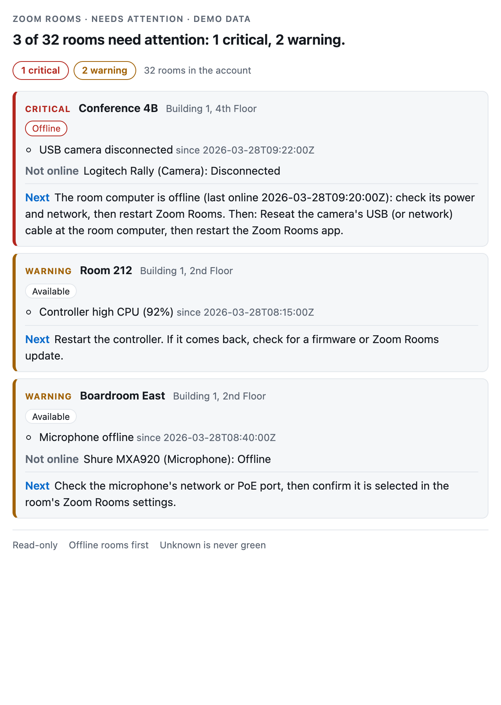

# zoom-rooms-mcp

An [MCP](https://modelcontextprotocol.io) server for **Zoom Rooms**. Ask Claude, Cursor, or any MCP client "which rooms have problems right now?" and get an answer from your Zoom account: room status, health, open issues and the devices in each room.

- **Read-only toward Zoom.** Nothing changes in Zoom. Six of the 7 tools are annotated `readOnlyHint: true`; `what_changed` is not, only because it writes its own snapshot file on this computer.
- **Runs without an account.** `--demo` serves a fictional 32-room campus, so you can try it before you have credentials. With no credentials set it starts in demo mode on its own.
- **Local and simple.** One stdio server you run yourself. No website, no hosted service, no sign-in.
- **Per-account token cache.** Server-to-Server OAuth tokens are cached per account and client, never shared across credentials.

## Try it (no Zoom account)

```bash
git clone https://github.com/Pgarciapg/zoom-rooms-mcp && cd zoom-rooms-mcp
npm install && npm run build
node dist/cli.js --demo
```

## Add it to Claude

**Claude Code**

```bash
claude mcp add zoom-rooms \
  -e ZOOM_ACCOUNT_ID=... -e ZOOM_CLIENT_ID=... -e ZOOM_CLIENT_SECRET=... \
  -- node /path/to/zoom-rooms-mcp/dist/cli.js
```

**Claude Desktop** (`claude_desktop_config.json`)

```json
{
  "mcpServers": {
    "zoom-rooms": {
      "command": "node",
      "args": ["/path/to/zoom-rooms-mcp/dist/cli.js"],
      "env": {
        "ZOOM_ACCOUNT_ID": "...",
        "ZOOM_CLIENT_ID": "...",
        "ZOOM_CLIENT_SECRET": "..."
      }
    }
  }
}
```

Leave out `env` to run on demo data.

## Zoom credentials

Create a **Server-to-Server OAuth** app at [marketplace.zoom.us](https://marketplace.zoom.us) and add the Zoom Rooms **read** scopes for listing rooms, room details and room devices (the app's Scopes page lists them). Then set:

| Variable | What it is |
|---|---|
| `ZOOM_ACCOUNT_ID` | Account ID from the app's credentials page |
| `ZOOM_CLIENT_ID` | Client ID |
| `ZOOM_CLIENT_SECRET` | Client secret |
| `ZOOM_CREDENTIALS_FILE` | Optional. A dotenv file holding the three values above. Environment variables win. |
| `ZOOM_API_BASE_URL` | Optional. Defaults to `https://api.zoom.us/v2`. |
| `ZOOM_ROOMS_STATE` | Optional. Where `what_changed` keeps its last check. |

If only some of the three are set, the server refuses to start and names what is missing, so a typo never quietly drops you into demo mode.

## Tools

| Tool | Zoom API | Returns |
|---|---|---|
| `get_rooms_needing_attention` | `GET /rooms`, then `GET /rooms/{roomId}` and `/devices` for each problem room | Start here: problem rooms worst first, with open issues, devices not online, whether a meeting is running now, and a plain next step. Never an all-clear while something could not be read |
| `what_changed` | `GET /rooms`, then `GET /rooms/{roomId}` and `/devices` for rooms that look unhappy now or did last time (up to 25) | What changed since the last run: rooms offline or back, health worse or better, issues opened or closed, devices down or recovered, rooms added or removed, worst first. Saves one private file per account (`~/.zoom-rooms-mcp/last-check-<account fingerprint>.json`, mode 600; `ZOOM_ROOMS_STATE` moves it). First run says there is nothing to compare. Anything not read now or last time is "not compared", never fixed. Rooms are only called added or removed between two full room lists. Demo compares against a built-in day-earlier campus in memory |
| `diagnose_rooms` | `GET /rooms`, then `diagnose_room` for each problem room | Shared causes across problem rooms: room computers offline on the same floor, one device model or firmware failing in several rooms, the same problem in several rooms. Worst first, one check each, then a per-room list. Never an all-clear while something could not be read |
| `diagnose_room` | `GET /rooms/{roomId}` and `/devices` (plus `GET /rooms` if the detail lacks status or health) | Why one room is unhappy and what to check first: the room computer, each open issue and each device not online, an issue and its failing device joined into one finding, worst first, one check each. Never an all-clear while something could not be read |
| `list_zoom_rooms` | `GET /rooms` (every page) | Every room with status and health. Reads all pages, up to 15,000 rooms; a page that fails fails the call, and past the cap the result keeps Zoom's `next_page_token` so it never passes as the whole list |
| `get_zoom_room` | `GET /rooms/{roomId}` | One room's details and open issues |
| `get_zoom_room_devices` | `GET /rooms/{roomId}/devices` | Cameras, mics, speakers, controllers, displays |

In hosts that support MCP Apps (Claude, ChatGPT), `get_rooms_needing_attention` also shows a card: each problem room worst first with its issues, the devices not online, an "in a meeting" flag and the next step. The card copies the tool result and loads nothing from the network. Other hosts get the same text and JSON as before.



Each result has the raw JSON as text plus `structuredContent: { source: "zoom" | "demo", data }`. Unknown rooms come back as a clean tool error.

## Development

```bash
npm run typecheck
npm test          # builds, then unit tests plus an end-to-end stdio run of the CLI
```

## About

Built by [Downriver Labs](https://downriverlabs.com), which builds MCP connectors that connect a business's own systems to AI assistants. Sister project: [qsys-reflect-mcp](https://github.com/Pgarciapg/qsys-reflect-mcp) for Q-SYS Reflect.

MIT license.
